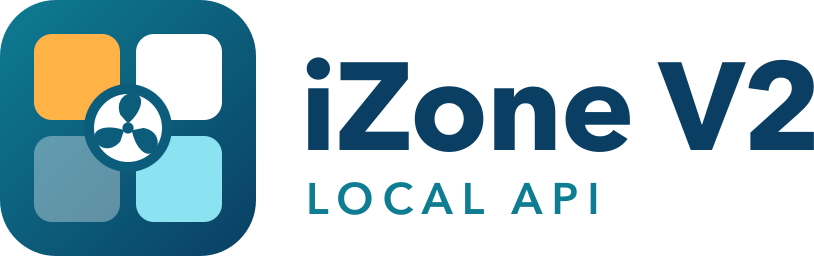

<picture>
  <source media="(prefers-color-scheme: dark)" srcset="custom_components/izone_v2/brand/dark_logo@2x.png">
  
</picture>

# iZone V2 — Home Assistant custom integration

[](https://github.com/andrewgould/izone-v2/actions/workflows/ci.yml)
[](LICENSE)

[](https://my.home-assistant.io/redirect/hacs_repository/?owner=andrewgould&repository=izone-v2&category=integration)

A Home Assistant custom integration for iZone that speaks the officially
documented **iZone local API ("V2")** from the
[iZone Developer Portal](https://developer.izone.com.au/).

> [!NOTE]
> **Most people should use the built-in integration.** Home Assistant's
> built-in [`izone`](https://www.home-assistant.io/integrations/izone/)
> integration is the supported path, and from Home Assistant 2026.11
> (`python-izone` 1.3.11) it speaks V2 too. This integration is an
> experimental V2 playground: extra entities, plus workarounds found on one
> installation with a noisy RF environment. The aim is to fold the useful parts
> into the built-in integration. Use this one if you need something from
> [Features only here](#features-only-here-today) that the built-in integration
> doesn't do yet.

## How this compares to the built-in integration

This integration started when the built-in one spoke only the legacy v1 API and
didn't work on this installation. Since then the
[`python-izone` / `pizone`](https://github.com/Swamp-Ig/pizone) library behind
the built-in integration has gained V2 support (1.3.11, released October 2026,
shipping with Home Assistant 2026.11). The comparison below is against that
version.

### Protocol: now mostly the same

- **V2 reads and writes.** The built-in integration reads over V2 whenever the
  bridge returns usable data, sends commands through `iZoneCommandV2`, and falls
  back to v1 only on bridges that need it. This integration is V2-only.
- **Fan speed *Top*** is sent as `SysFan` 5 over V2, as the spec defines.
- **HTTP** goes through aiohttp in both. The built-in integration probes
  whether the bridge wants a `Content-Type` header and remembers the answer.
- **More than 12 zones.** V2 reads cover every zone in `NoOfZones`.
- **Discovery** (UDP `IASD` to port 12107) and listening for `iZoneChanged_*`
  on UDP 7005 match the spec in both.

### Protocol: what still differs

- **V2-only states.** The built-in integration translates V2 data into its v1
  vocabulary. Zone modes *Override* (4) and *Constant* (5), and the Coolbreeze
  unit modes *Exhaust* and *PumpOnly*, have no v1 equivalent, so they currently
  read as a closed zone and as cool. Here, Override reads as climate control,
  Constant as open, Exhaust as fan-only and PumpOnly as dry.
- **`{BUSY}` replies.** This integration paces commands and retries a command
  the bridge answers with `{BUSY}` (seen here when many zones are commanded at
  once, or while a damper is still moving). The built-in integration plans to
  add this.
- **Change notifications.** This integration treats any `iZoneChanged_*` packet
  as a prompt to poll early. On this firmware they arrive about 3 s after a real
  change and never after a no-op, but they have been seen with no link to
  changes on other hardware. In both integrations the regular poll (30 s here,
  25 s built-in) is the source of truth.
- **Request types outside the published spec.** Firmware versions come from
  request Type 6, which the published spec doesn't cover.

### Features only here (today)

The built-in integration gives you a climate entity for the unit and one per
zone, supply and return temperature sensors, Free Air as the Eco preset, zone
airflow limits as services, and diagnostics. This integration adds:

- each zone as its own device, with the zone name as its suggested area
- damper position, wireless sensor battery and signal strength
- damper fault, sensor fault and filter warning binary sensors
- control zone, AC run hours and firmware sensors
- an iSave switch, a sleep timer number, and zone airflow limits as numbers
- favourites as scenes, plus a service to edit what a favourite stores
- bridge health: overloaded, recent command failures, pending zone changes
- a setpoint sent to a closed zone switches it to climate control first, then
  sends the setpoint once the zone reads back (the controller otherwise drops
  it)
- favourites the controller only partly applies are re-applied and checked

This integration implements the V2 API as documented (verified against
`iZone_JSON_datastrings.h` v1.41, the Developer Portal reference pages and
iZone's official Postman collection).

## Requirements

Your bridge must support the V2 API — its discovery response includes
`iZoneV2`. Almost every hub shipped since ~2017 does. If your bridge responds
with only `iZone`, use the built-in integration, which also speaks v1.

## Installation

**Manual:** copy `custom_components/izone_v2/` into your Home Assistant
`config/custom_components/` directory and restart Home Assistant.

**HACS:** click the "Open in HACS" badge above to open this repository directly
in your own Home Assistant instance (requires the My Home Assistant integration,
which is on by default), or add it manually as a custom repository
(type: Integration). Then install "iZone V2 (Local API)" and restart.

Then: *Settings → Devices & Services → Add Integration → iZone V2 (Local API)*.
Bridges are discovered automatically (UDP broadcast); you can also enter the
IP address manually.

## What you get

| iZone concept | Home Assistant entity |
|---|---|
| AC unit | `climate` — off/cool/heat/heat-cool/fan-only/dry, the fan speeds the unit has (from `FanAutoType`: low/med/high/auto on a 3-speed fan, plus top on a 4-speed one), setpoint (0.5 °C steps, Eco-lock limits respected) |
| Temperature-controlled zones | `climate` per zone — off (close) / fan-only (open) / heat-cool (climate control) + zone setpoint |
| Open/close & constant zones | `switch` per zone (on = damper open) |
| iSave | `switch` (only if the system supports it) |
| Supply air temperature | `sensor` |
| Control temperature | `sensor` — the temperature the unit is run from. The spec calls it return air, but on a zone-controlled system it is the control zone's temperature; attribute `control_zone` |
| Control zone | `sensor` (diagnostic) — the zone the unit is following right now. It moves between zones, and the unit eases off as that zone nears its setpoint |
| AC run hours | `sensor` (diagnostic, total increasing) — the controller's run-hours counter (`AcRunH`, not in the published spec) |
| Zone temperature | `sensor` per zone with a sensor |
| Damper position | `sensor` per zone (diagnostic) |
| Wireless sensor battery | `sensor` (full/half/empty, diagnostic) |
| Wireless sensor signal strength | `sensor` (full/half/quarter/none, diagnostic) |
| Filter warning, damper fault, sensor fault | `binary_sensor` (diagnostic). The filter warning is the controller's reminder timer running out; attribute `reminder_interval_months` |
| Bridge overloaded | `binary_sensor` (diagnostic) — on when commands are repeatedly failing |
| Command failures (recent) | `sensor` (diagnostic) — count of failed commands in the last 5 min |
| Pending zone changes | `sensor` (diagnostic) — zones still being brought to a scene's target; attributes say which and why |
| Firmware (hub, wall controller, each board) | `sensor` (diagnostic) per module, e.g. `4.36`; attribute `module` is the part code. Read every 6 hours from request Type 6 (not in the published spec). The hub version also shows on the bridge's device page. Updates can only be installed from the iZone app; these show what's installed and when it changes |
| Sleep timer | `number` (0–120 min in 30-min steps) |
| Zone min/max airflow | `number` per zone (config; disabled by default) |
| Favourites | `scene` per configured favourite (up to 9) |

Wireless zone sensors (battery-powered) also expose signal strength and battery
level, so a sensor drifting toward "none"/"empty" can be caught before it drops
out entirely (shows up as the zone temperature going `unknown`). The damper/sensor
fault binary sensors are enabled by default for the same reason — none of this
costs extra requests to the bridge, since it all rides along in the zone data
already being polled every 30 s.

**Heat/cool are whole-unit modes.** `heat` / `cool` / `dry` are set on the **AC
unit** climate entity; each **zone** entity exposes only `off` (closed),
`fan_only` (open), and `heat_cool` (climate control) — a zone follows the unit,
it has no heat/cool of its own. `climate.set_temperature` may bundle an
`hvac_mode` (it's applied before the setpoint), and asking a zone for a
unit-level mode returns a clear error rather than silently doing nothing — so a
blanket "set the unit *and* its zones to heat 22°" should set `heat` on the unit
and `heat_cool` on the zones.

**A zone only holds a setpoint under climate control.** The controller throws
away a setpoint sent to a closed or open zone: instead it switches the zone to
climate control at its *old* setpoint. So setting a temperature on a zone that's
`off` turns it on (`heat_cool`) first, and the setpoint is sent once the zone
reads back as climate-controlled, usually a few seconds later. With
`hvac_mode: off` or `fan_only` bundled in, the mode is applied and the
temperature is skipped, with a warning in the log.

Each zone is its own Home Assistant **device**, named after the zone and with the
zone name as its *suggested area* — so entities land in the right room by default
and can be re-assigned per zone. Diagnostics download is supported for issue
reports (Settings → Devices → iZone bridge → Download diagnostics).

### Notifications

The integration raises Home Assistant persistent notifications for two things:

- **Filter due for a clean**, while the controller's filter warning is on. It's raised once per warning (dismissing it won't bring it back every poll) and cleared automatically when the warning goes, i.e. after the reminder is reset on the wall controller or in the iZone app.
- **Firmware updated**, when a module's version changes (checked every 6 hours), listing what changed.

Turn them off under the integration's **Configure** options.

### Recovering a wedged bridge

The iZone bridge is a single-connection embedded server. If it's hit with a
burst of commands — e.g. a Home Assistant scene that sets many zone climate
entities at once — it can fall behind and reply `{BUSY}` to everything until it
catches up. Commands are **paced** (a short gap is held between them) to soften
these bursts, and retried with backoff; but if the bridge stays busy the command
is eventually abandoned (and logged) rather than queued forever. Note that
`{BUSY}` often originates with the wall controller (the actual brain), which the
bridge relays — so persistent busy states can point at the controller or a
faulty zone (e.g. a climate zone whose wireless sensor keeps dropping out),
not the bridge itself.

The **Bridge overloaded** binary sensor turns on when commands keep failing
(≥3 failures within 5 minutes), and the **Command failures** sensor exposes the
running count. Use either to drive a recovery automation — for example, power-
cycling the hub via a smart plug:

```yaml
automation:
  - alias: Power-cycle iZone hub when overloaded
    triggers:
      - trigger: state
        entity_id: binary_sensor.izone_XXXXXXXXX_bridge_overloaded
        to: "on"
        for: "00:02:00"
    actions:
      - action: switch.turn_off
        target: { entity_id: switch.izone_hub_power }
      - delay: "00:00:20"
      - action: switch.turn_on
        target: { entity_id: switch.izone_hub_power }
```

To avoid triggering the overload in the first place, prefer this integration's
own **favourite `scene` entities** (a single `FavouriteSet` command the bridge
applies internally) over HA-native scenes that set every zone individually.

**Favourites** (saved AC mode/fan/setpoint + per-zone presets in the iZone app)
show up as `scene` entities, named after the favourite. Only slots with a name
set are exposed — empty slots are skipped. Favourites are discovered once when
the integration starts, not on every poll, since they rarely change; reload the
integration (Settings → Devices & Services → iZone V2 → ⋮ → Reload) after
adding or renaming a favourite in the iZone app to pick up the change.

Each favourite scene shows what it stores as attributes: `zones` (for example
`Living: auto 20.0`, `Rumpus: close`), `fan` and `mode` (`unset` means the
favourite leaves the unit's fan or mode alone), plus `favourite_number`.
They're read at startup, and again whenever the scene is activated or edited.

**Favourites can be edited from Home Assistant** with the
`izone_v2.update_favourite` action, using the documented "Set Schedule Zone
Settings", "Change Schedule AC Fan" and "Change Schedule AC Mode" commands. The
edit is saved on the controller, so the iZone app and wall controller see it
too. Nothing is applied until the favourite is next activated.

```yaml
action: izone_v2.update_favourite
target:
  entity_id: scene.izone_000104158_morning_heating
data:
  zone: Front office    # name as in the iZone app, any case, or zone number
  zone_mode: close      # open | close | auto
  # temperature: 19     # 15-30 in 0.5 steps; leave out to keep the stored one
  # fan: high           # unset | low | medium | high | auto | top
  # mode: heat          # unset | cool | heat | vent | dry | auto
```

One call changes one zone, but the fan and mode can go in the same call.
Constant (bypass) zones are refused, because the controller manages them. So is
`auto` on a zone without a temperature sensor. The integration reads the
favourite back afterwards and reports an error if the controller didn't keep
the change.

When a favourite scene is activated, the integration **reads the zones back and
confirms** they match the favourite's stored config, re-applying a couple of
times if they don't (controller-managed constant zones are skipped).

**Scenes are followed through.** The controller often answers `{OK}` and then
leaves some zones where they were, and a zone whose wireless sensor has dropped
out can't take a climate target at all. So after a scene, each zone's target is
kept and checked on every poll until the zone matches it:

- whatever is still missing is re-sent, at most once a minute and at most 10
  times. A setpoint is only ever sent to a zone that's already under climate
  control, for the reason above.
- a zone with a faulted sensor is left alone until the sensor comes back. The
  controller reports a faulted zone as closed and, on recovery, resumes the
  mode and setpoint it last remembered. The integration then corrects the zone
  to the scene's target, even hours later.
- a target is dropped when a newer scene replaces it, when the zone is changed
  from Home Assistant, the iZone app or the wall controller (the newer change
  wins), or after 12 hours.

The **Pending zone changes** sensor shows what's outstanding, and the log
records each zone that lands late or is given up on. Targets live in memory, so
a Home Assistant restart forgets them.

**Resilient to dropped zones.** If a favourite drives a climate (Auto) zone
whose sensor is faulted, the controller refuses to apply the favourite as a
whole — historically that meant the *entire* scene silently failed, healthy
zones included. When this is detected, the integration instead applies the
scene **zone by zone**: every healthy zone (and any open/close target, which
needs no sensor) takes effect immediately, and each faulted climate zone waits
for its sensor as described above. So a single flaky wireless sensor no longer
blocks the rest of the scene.

State refreshes every 30 s. The bridge's `iZoneChanged_*` UDP 7005 broadcasts
also nudge a prompt refresh — a controlled test showed a real state change
triggers a content-free broadcast ~3 s later (a no-op command triggers none), so
they're change-driven on this firmware and only look ~60 s-periodic in passive
capture because routine sensor-reading updates keep firing them. They're treated
as a best-effort hint on top of the 30 s poll, which remains the fallback so
state stays correct if a broadcast is missed. All requests are serialised — the
bridge's embedded HTTP server can't handle concurrent requests.

## Protocol summary (V2)

| Action | Request |
|---|---|
| System state | `POST /iZoneRequestV2` `{"iZoneV2Request":{"Type":1,"No":0,"No1":0}}` |
| Zone *n* state | `POST /iZoneRequestV2` `{"iZoneV2Request":{"Type":2,"No":n,"No1":0}}` |
| System on/off | `POST /iZoneCommandV2` `{"SysOn":0\|1}` |
| Mode | `{"SysMode":1..5}` (cool, heat, vent, dry, auto) |
| Fan | `{"SysFan":1..5}` (low, med, high, auto, top) |
| Unit setpoint | `{"SysSetpoint":2250}` (°C ×100) |
| Zone mode | `{"ZoneMode":{"Index":n,"Mode":1\|2\|3}}` (open, close, climate) |
| Zone setpoint | `{"ZoneSetpoint":{"Index":n,"Setpoint":2250}}` |
| Favourite *n* state | `POST /iZoneRequestV2` `{"iZoneV2Request":{"Type":3,"No":n,"No1":0}}` |
| Trigger favourite *n* | `POST /iZoneCommandV2` `{"FavouriteSet":n+1}` (1-9) |

Commands normally return the literal string `OK` on success. Real bridges also
reply with v1-style bracing (`{OK}`) and, while still actuating a previous
command (e.g. a damper motor in transit), `{BUSY}` — which this integration
retries automatically rather than treating as a failure.

The bridge is a single-connection embedded server and occasionally drops or
times out a request (especially just after a command, while it's actuating).
Both reads and commands are retried a couple of times before being reported as
a failure, so a single dropped request doesn't knock every entity offline.
Scene entities stay available regardless of poll state, since triggering a
favourite doesn't depend on fresh data.

Now and then the bridge answers a read with HTTP 200 but every live field
zeroed (`SysOn`, `SysMode`, `SysFan` and the temperatures all `0`, zones with
`Mode` 0) while the unit is running. Mode and fan 0 are the spec's `_Na`
values, so such a reply is ignored and the last state kept. If the replies are
still zeroed after 5 minutes, the controller has probably stopped talking to
the bridge, and the entities go unavailable.
